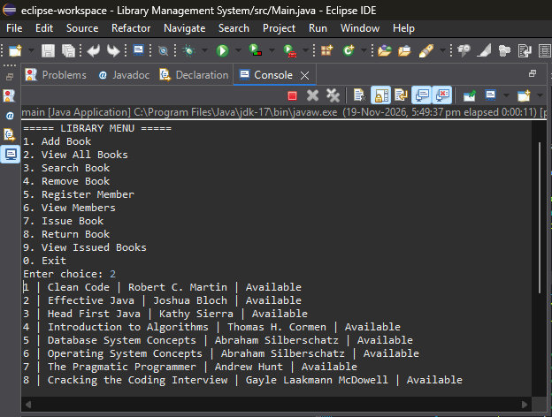
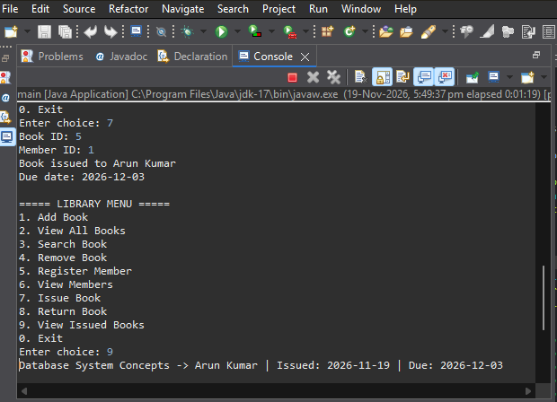
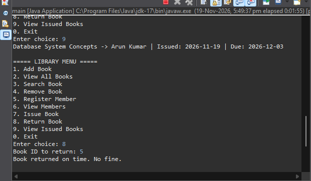

# Library Management System

A console-based Library Management System built with Java, JDBC and MySQL. It manages books, members and issue/return records, with due dates and late fines.

## Features
- Add, view, search and remove books
- Register and view members
- Issue and return books with a 14-day due date
- Late fine of Rs. 2 per day, calculated on return
- View all currently issued books, with overdue flags
- Data saved permanently in MySQL

## Tech Stack
Java 17, JDBC, MySQL 8, SQL joins, Eclipse, Git

## Database Design
Three tables: `books`, `members` and `issues`. The `issues` table has two foreign keys (`book_id` and `member_id`), so every issue record points to a real book and member. Deleting a book that has issue history is blocked.

## How to Run
1. Install Java 17 and MySQL.
2. Run `schema.sql` in MySQL to create the database and sample data.
3. Download MySQL Connector/J and add the jar to your project's build path.
4. Copy `config.properties.example` to `config.properties` and enter your MySQL password.
5. Run `Main.java`.

## Screenshots
**Menu and book list**

**Issuing a book with due date**

**Returning a book**

## What I Learned
- OOP design and separation of classes
- JDBC with PreparedStatement, which prevents SQL injection
- Transactions with commit and rollback
- Foreign keys and referential integrity
- Input validation and error handling